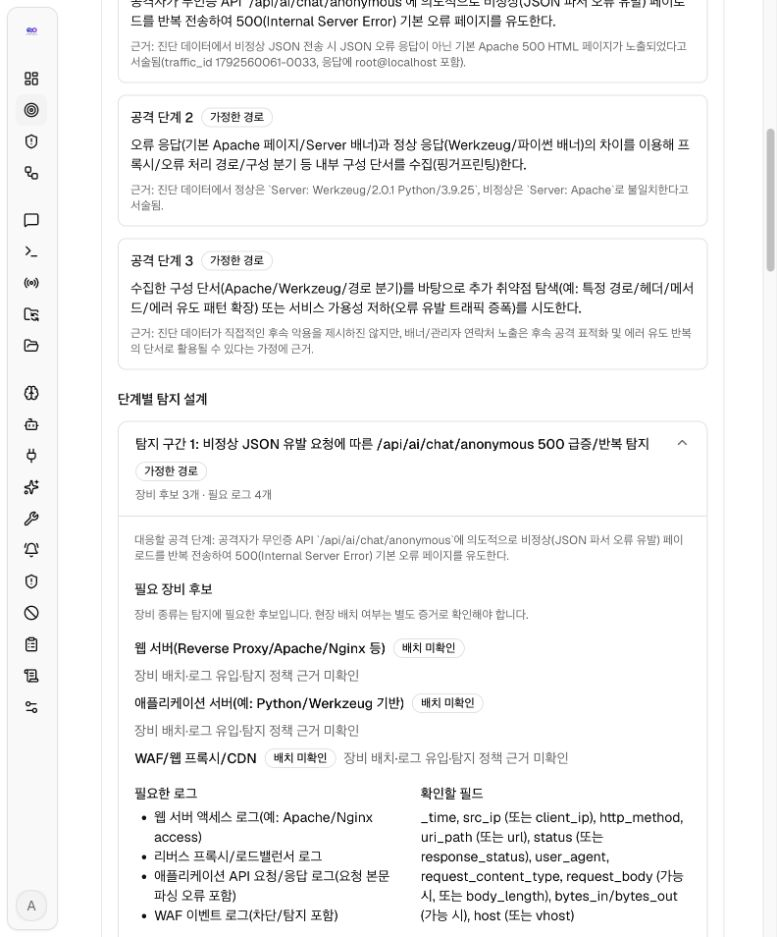
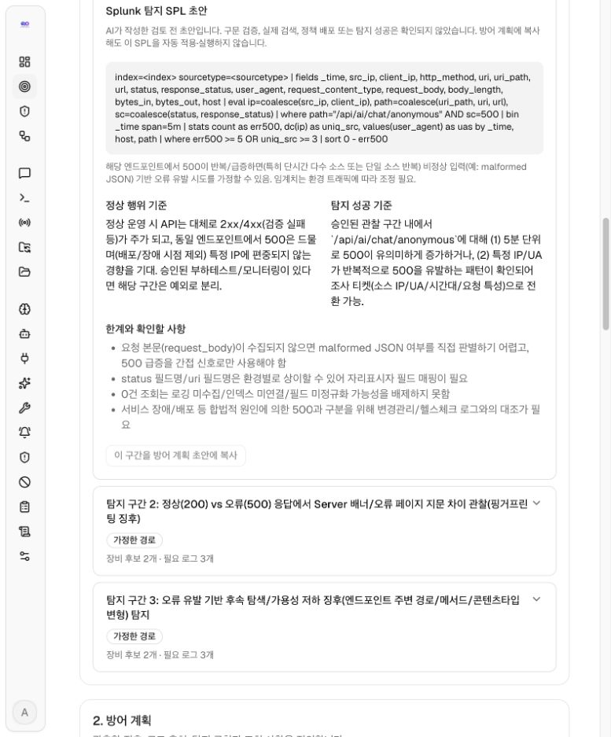
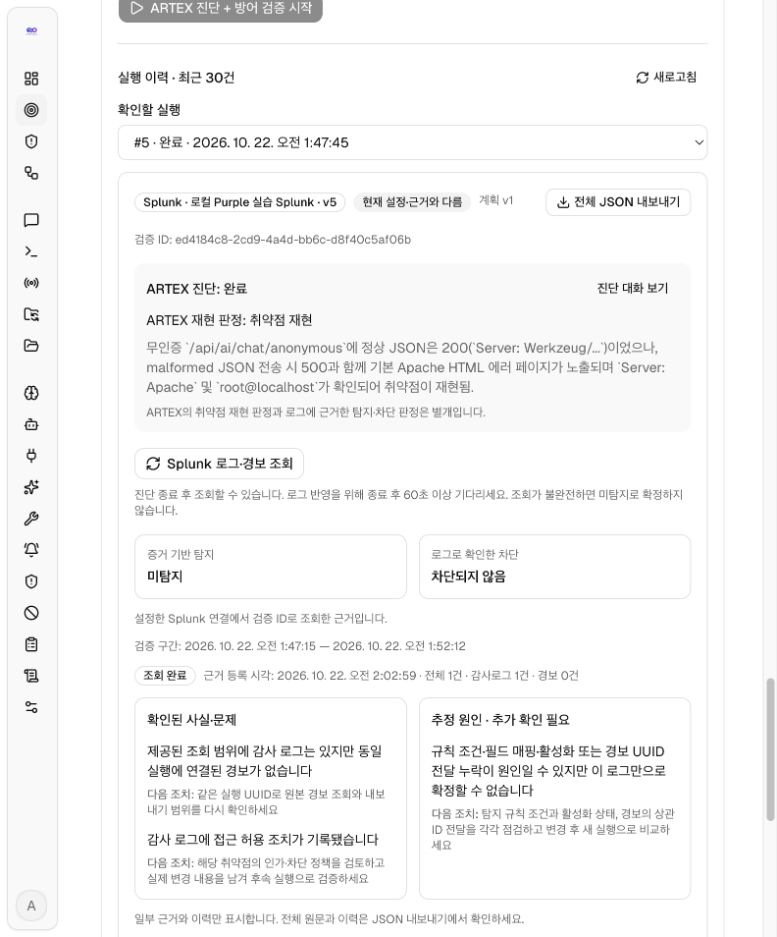
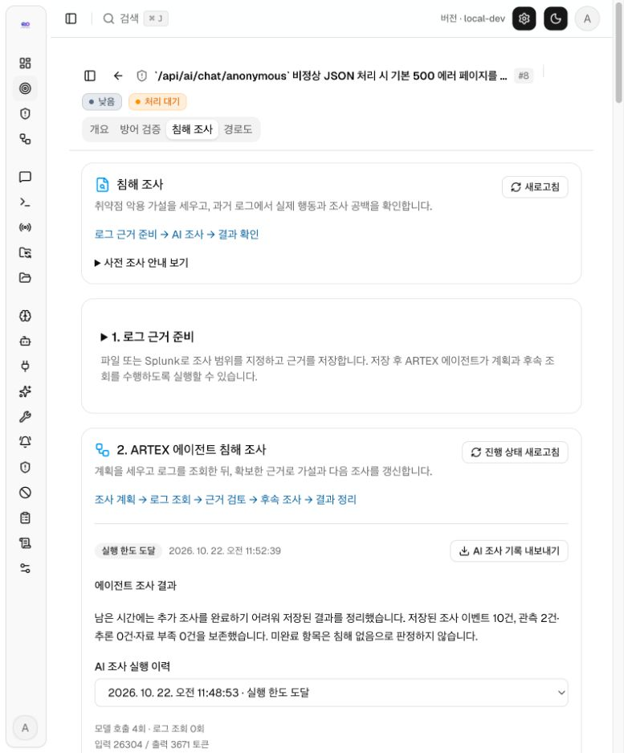
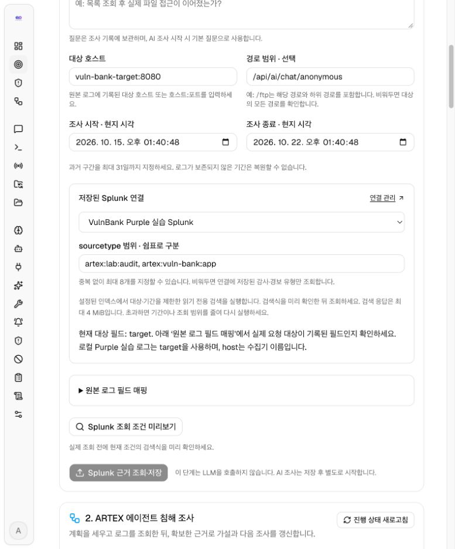
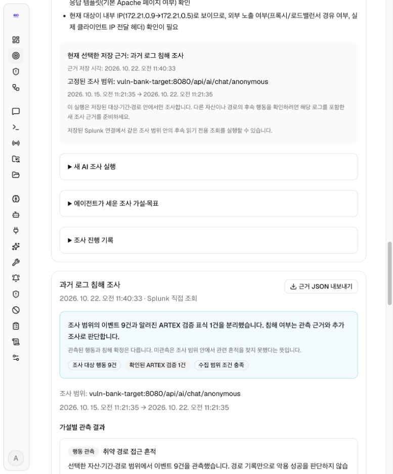
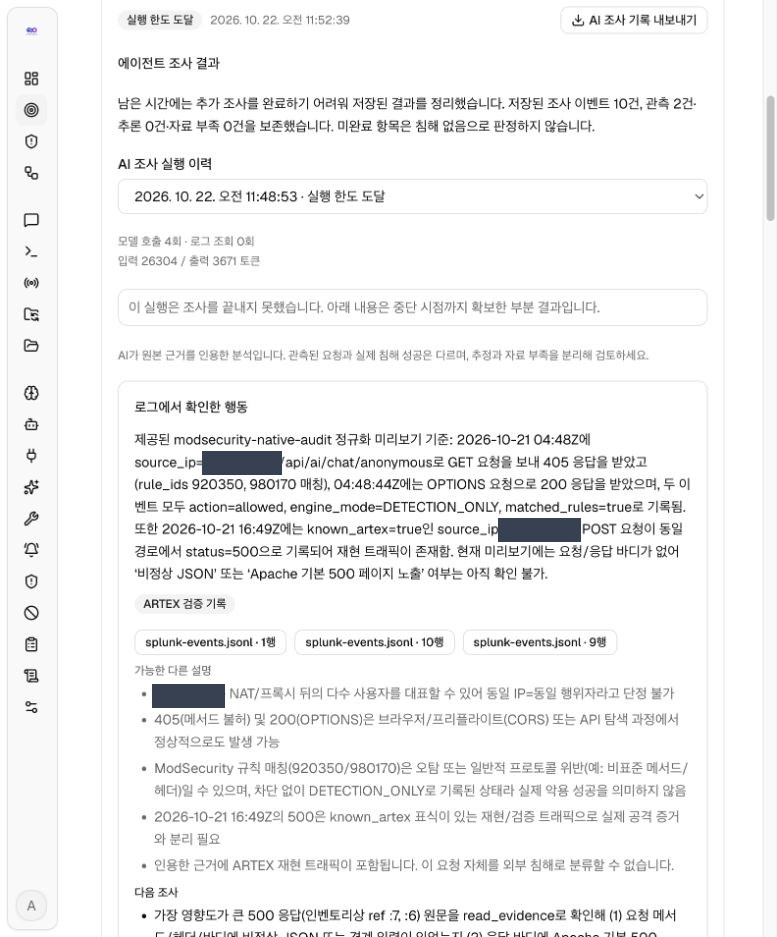

# 취약점에서 방어 검증과 침해 조사까지

이 문서는 AegisLoop에서 하나의 취약점을 기준으로 **진단 근거 → 방어 검증 → 침해 조사**를 진행하는 방법을 설명합니다. 화면에 표시되는 취약점 번호와 결과는 설치·실행마다 달라집니다.

아래 화면 캡처는 2026년 10월 22일 로컬 실습의 취약점 #8 기록입니다. 설치 패키지에 이 취약점·로그·조사 결과가 포함된다는 뜻은 아닙니다.

## 시작 전 준비

- 허가된 진단 대상의 취약점이 **취약점 목록**에 기록되어 있어야 합니다.
- AI 시나리오 생성과 AI 침해 조사를 사용할 경우 **시스템 → LLM**에서 모델을 설정합니다. 두 기능은 명시적으로 실행할 때 모델 비용이 발생할 수 있습니다.
- Splunk 직접 조회를 사용할 경우 **Defensive → 로그 연결**에서 검색 계정과 조회할 인덱스·로그 유형을 설정합니다. 파일로 근거를 준비한다면 Splunk 연결은 필요하지 않습니다.

## 1. 취약점 근거 확인

**취약점 목록 → 취약점 상세 → 개요**에서 요약, 대상 자산, 요청 경로, 재현 근거를 확인합니다. 여기서 확인한 내용이 방어 시나리오의 출발점입니다. 발견 사실과 아직 검증되지 않은 추정을 구분하세요.

예를 들어 취약점 **#8**은 VulnBank의 `vuln-bank-target:8080`과 `/api/ai/chat/anonymous` 경로에 관한 기록입니다. 이 주소와 번호는 현재 실습의 예시이며 다른 환경에 고정해서 입력하는 값이 아닙니다. 새 설치에 #8의 조사 결과가 자동으로 생기지는 않습니다.

*그림 1. 취약점 요약과 재검증 결과에서 방어·조사 대상의 근거를 확인합니다.*

## 2. 방어 검증

취약점 상세의 **방어 검증** 탭에서 진행합니다.

1. **1. 공격·탐지 시나리오 → AI 시나리오 생성**을 누릅니다. AI는 취약점 근거로 공격 흐름과 단계별 탐지 초안을 만듭니다. 시나리오 생성에는 Splunk 연결 설정이나 실제 로그 조회 결과를 사용하지 않습니다.
2. **단계별 탐지 설계**에서 각 **탐지 구간**을 펼쳐 장비 후보, 필요한 로그·필드, **Splunk 탐지 SPL 초안**, 정상 행위 기준과 탐지 성공 기준을 확인합니다. 장비 후보의 실제 배치 여부와 로그 연동 여부는 별도 근거로 확인해야 합니다.
3. 사용할 탐지 구간의 **이 구간을 방어 계획 초안에 복사**를 누릅니다. **2. 방어 계획**에서 탐지 가설·로그 출처·규칙 초안·조치를 검토한 뒤 **계획 저장**을 누릅니다. SPL 초안은 Splunk에 자동 적용되거나 실행되지 않습니다.

화면 캡처: 탐지 구간의 장비·로그·SPL 초안

*그림 2. 장비 후보와 필요한 로그를 구간별로 확인합니다. 배치 미확인은 실제 장비 존재 여부를 확인해야 한다는 뜻입니다.*

*그림 3. SPL은 초안입니다. 캡처 당시 초안은 이전 생성 기준이라 방어 계획으로 복사하려면 현재 근거로 다시 생성해야 합니다.*

4. **ARTEX 진단 → 증거 기반 방어 검증**에서 **1. 검증 근거 연결** 방식을 파일 또는 Splunk로 선택하고 **ARTEX 진단 + 방어 검증 시작**을 누릅니다. 이 실행은 기존 진단 작업의 허가된 범위 안에서 취약점을 다시 확인합니다.
5. 진단이 끝난 뒤 실제 감사로그·경보를 연결합니다. Splunk를 선택했다면 로그 반영을 위해 종료 후 60초 이상 기다린 뒤 **Splunk 로그·경보 조회**를 누릅니다. 파일을 선택했다면 같은 실행 구간의 감사로그와 경보 파일을 **2. 실제 로그 파일 등록**에서 올립니다.
6. 실행 결과에서 **ARTEX 재현 판정**, **증거 기반 탐지**, **로그로 확인한 차단**을 각각 읽습니다. 개선 전후 효과를 확인하려면 **개선 전 기준 실행**을 선택하고 적용한 개선 조치를 적어 다시 실행한 뒤 **개선 전후 비교**를 확인합니다.

진단 요청과 로그는 실행별 검증 ID로 연결합니다. 감사로그와 경보의 ID·시각·차단/허용 조치를 확인하세요. 취약점이 재현됐다는 사실만으로 탐지나 차단을 판정하지 않으며, 경보가 발생해도 요청은 허용됐을 수 있습니다. 필요하면 **3. 관측 결과 기록**에 확인한 근거와 판단을 별도로 남깁니다.

*그림 4. 실습 실행 #5에서는 취약점 재현, 증거 기반 미탐지, 차단되지 않음이 각각 표시됩니다. 이 판정은 해당 실행의 조회 범위에만 적용됩니다.*

## 3. 침해 조사

같은 취약점 상세의 **침해 조사** 탭은 화면에 적힌 순서대로 사용합니다: **로그 근거 준비 → AI 조사 → 결과 확인**. 상단의 **사전 조사 안내 보기**는 취약점과 방어 검증 근거에서 만든 조사 가설 참고 자료입니다. 과거 침해가 확인됐다는 뜻은 아닙니다.

*그림 5. 화면은 로그 근거 준비, AI 조사, 결과 확인 순서입니다. 예시 실행은 한도 도달 상태이므로 결과가 부분 기록입니다.*

### 1. 로그 근거 준비

1. **1. 로그 근거 준비**를 펼칩니다. 저장된 조사가 있으면 기본으로 접혀 있습니다.
2. **파일 업로드** 또는 **Splunk 직접 조회**를 선택하고 대상 호스트, 경로 범위, 조사 시작·종료 시각을 지정합니다. 조사 기간은 최대 31일입니다. 예시 #8에서는 대상과 경로가 각각 `vuln-bank-target:8080`, `/api/ai/chat/anonymous`였지만 실제 값은 조사할 로그에 맞춰야 합니다.
3. 필요하면 **조사 질문·메모**, `sourcetype` 범위, **원본 로그 필드 매핑**을 확인합니다. 대상 필드는 실제 요청 대상이 기록된 필드여야 합니다. 로컬 Purple 실습 로그는 `target`을 사용하며 Splunk의 `host`는 수집기 이름일 수 있습니다.
4. 파일 방식은 **파일 근거 준비·저장**, Splunk 방식은 **Splunk 조회 조건 미리보기 → Splunk 근거 조회·저장**을 진행합니다. 이 단계는 LLM을 호출하지 않습니다. Splunk 방식은 저장된 연결의 인덱스에서 지정한 대상·기간·경로를 읽기 전용으로 조회합니다.

화면 캡처: Splunk 조사 범위와 저장된 로그 근거

*그림 6. 대상·기간·경로, 저장된 Splunk 연결과 `sourcetype` 범위를 지정합니다. 화면의 값은 실습 예시입니다.*

*그림 7. 저장된 Splunk 근거는 조사 범위의 행동 이벤트 9건과 ARTEX 검증 1건을 분리해 보여줍니다. 이벤트 관측은 침해 확정이 아닙니다.*

저장된 로그 근거 결과는 준비한 로그를 조회·정리한 내용입니다. 예시 #8 화면의 **과거 로그 침해 조사**는 해당 기록에 붙인 조사 이름입니다. 이름을 비워두면 **기초 로그 분석**이 기본 제목으로 표시됩니다. 이 결과는 이후에 별도로 실행하는 AI 침해 조사 결과와 구분해야 합니다. 이벤트 수와 타임라인은 지정한 범위의 관측 근거이며 침해 확정 건수가 아닙니다.

### 2. ARTEX 에이전트 침해 조사

저장된 로그 근거를 확인한 뒤 **2. ARTEX 에이전트 침해 조사 → AI 조사 시작**을 누릅니다. 원하면 **이번 조사에서 확인할 질문**을 추가합니다. AI는 저장된 범위 안에서 근거를 검토하고, Splunk 근거라면 같은 범위의 후속 읽기 전용 조회를 할 수 있습니다. 파일에 없는 로그는 추가로 가져올 수 없습니다.

AI 조사 시작 시 취약점 근거와 선택된 로그 내용이 설정한 LLM으로 전송됩니다. Splunk 인증 정보는 포함되지 않습니다. 실행에는 모델 호출·조회·시간 한도가 있습니다. **실행 한도 도달**, **사용자 중지**, **모델 연결 오류** 등으로 끝나면 표시된 내용은 부분 결과이므로 미확인 항목을 계속 조사해야 합니다.

### 결과 확인

**에이전트 조사 결과**에서 실행 상태, **로그에서 확인한 행동**, **근거를 연결한 추정**, **근거 부족·확인되지 않은 가설**, **추가로 필요한 로그**, **다음 조사**를 확인합니다. 근거 표시를 눌러 원본 이벤트와 인용 출처를 대조하세요. **조사 진행 기록**과 **조사 이력**은 필요할 때 펼쳐 봅니다.

*그림 8. AI가 기록한 관측 내용과 인용 근거입니다. 공개용 캡처에서는 출처 IP 값만 가렸습니다. 이 실행은 한도 도달로 중단됐으므로 표시된 분석은 부분 결과입니다.*

알려진 ARTEX 재현 요청은 가능한 경우 별도 표식으로 분리됩니다. 표식만으로 요청자 신원을 인증하거나 다른 요청까지 ARTEX 실행으로 단정할 수 없습니다. 로그에서 관련 요청이 보이지 않아도 조사 범위 밖의 공격이 없었다는 뜻은 아닙니다. 결과와 근거는 각 화면의 **JSON 내보내기**로 보관할 수 있습니다.
