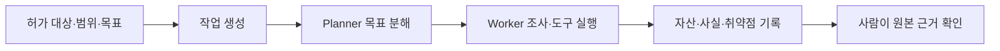
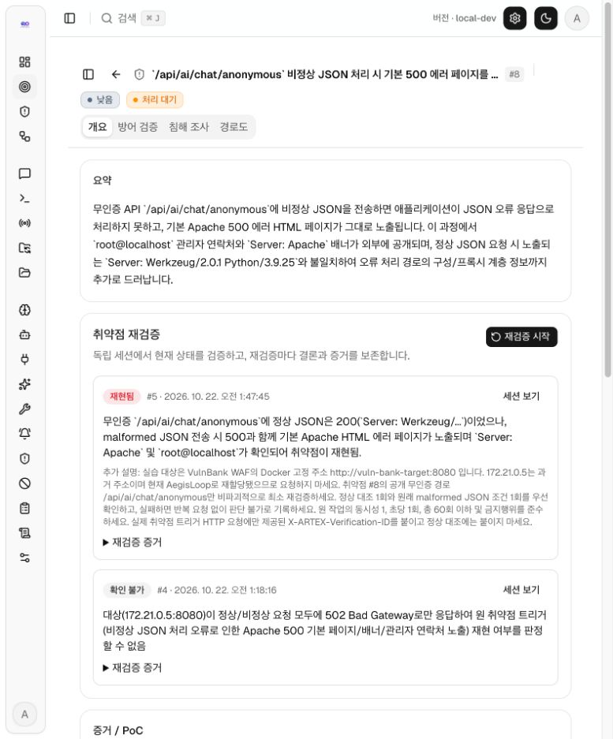

# Offensive 진단 가이드

이 문서는 AegisLoop의 **Offensive → 작업**에서 ARTEX 자율 진단을 시작하고, 결과 근거를 확인하는 순서입니다. **Offensive → 진단 현황**은 저장된 작업·취약점의 집계를 보여주며, 실제 실행은 **작업**에서 합니다. 현재 사용 경로는 ARTEX의 작업·Planner·Worker입니다. 과거에 시험한 별도 URL 진단 실행기는 이 절차에 포함되지 않습니다.

## 시작 전 확인

1. `./scripts/local-start.sh`로 앱을 실행합니다. 첫 설치라면 `http://localhost:8787/setup/`에서 관리자 계정을 만든 뒤 로그인합니다. 이후 기본 주소는 `http://localhost:8787`입니다.
2. **시스템 → LLM**에 사용할 모델 연결을 등록합니다. 진단 실행은 모델 사용량과 비용이 발생할 수 있습니다.
3. 본인이 소유하거나 점검 허가를 받은 대상의 **컨테이너에서 접근 가능한 주소**, 허용 경로와 기간, 진단 목표를 정합니다. 실습 대상은 기본 설치에 포함되지 않습니다.
4. 작업 단위 **허용 규칙**과 **작업 타임아웃**을 준비합니다. 새 작업에서 허용 규칙을 비워두면 화이트리스트가 적용되지 않으므로, 허가 범위를 설명에 적는 것과 별개로 규칙도 설정하세요.

## 1. 화면에서 새 작업 만들기

아래 입력값은 **별도로 실행하고 허가받은 로컬 VulnBank 실습**의 예시입니다. 새 설치에서는 자신의 컨테이너에서 접근되는 주소와 허가 범위로 바꿔 입력합니다.

1. 왼쪽 메뉴에서 **Offensive**를 펼치고 **작업**을 누릅니다. **진단 현황**은 저장된 결과를 보는 화면이며, 새 진단은 **작업**에서 만듭니다.
2. 작업 목록 오른쪽 위 **새 작업**을 누릅니다. 오른쪽에 입력창이 열립니다.
3. **이름(선택)**에 `VulnBank 익명 채팅 API 점검`처럼 식별할 이름을 적습니다.
4. **설명**에 대상과 허가 범위를 입력합니다. 아래는 이 실습에서 사용할 수 있는 입력 예시입니다.

   ```text
   대상: http://vuln-bank-target:8080
   허가 범위: /api/ai/chat/anonymous 경로의 비정상 JSON 처리 확인.
   같은 호스트의 다른 경로와 외부 주소는 이 작업에서 점검하지 않는다.
   ```

5. **목표**에 확인할 질문과 남길 근거를 입력합니다.

   ```text
   허가된 경로에서 비정상 JSON 요청에 대한 서버 응답과 정보 노출 여부를 확인한다.
   재현 여부를 요청·응답 원문과 조건으로 설명하고, 확인되지 않은 영향은 구분한다.
   ```

6. **작업 단위 자산 차단 / 허용 규칙(선택)**에서 **규칙 추가**를 누르고 동작을 **허용**으로 바꿉니다. 이 예시처럼 경로 하나만 허가됐다면 종류를 **URL(완전 일치)**로 선택하고 값에 `http://vuln-bank-target:8080/api/ai/chat/anonymous`를 입력합니다. 작업에 필요한 다른 주소도 허가받았다면 해당 범위만 별도 규칙으로 추가합니다. **허용 규칙을 하나도 넣지 않으면 화이트리스트가 적용되지 않습니다.**
7. **LLM 설정 체인**에서 사용할 모델 연결을 확인합니다. 여러 개를 고르면 첫 번째가 우선이고 나머지는 할당량 부족 시 예비 연결입니다. 이어서 **고급 설정**을 펼치고 **작업 타임아웃(분, 선택)**에 허가된 실행 시간에 맞는 값(예: `60`)을 입력합니다. 비워두면 시간 제한이 없습니다.
8. 입력값과 규칙을 다시 확인한 뒤 오른쪽 입력창 맨 아래 **생성**을 누릅니다. 입력창이 닫히고 작업 목록에 새 항목이 나타납니다. **생성하면 진단이 바로 시작되므로 별도의 시작 버튼은 없습니다.**

설명·목표의 문장만으로 범위가 기술적으로 강제되지는 않습니다. 작업 단위 허용 규칙과 실제 도구 기록을 함께 확인하세요. URL 완전 일치 규칙은 입력한 문자열에만 일치하므로, 허가된 조사에 필요한 다른 URL은 별도 규칙이 필요할 수 있습니다.

## 2. 실행 과정 보기



1. **작업** 목록에서 방금 만든 작업의 이름을 누릅니다.
2. 작업 상세 상단에서 실행 상태를 확인하고 **세션** 탭을 눌러 진행·모델 호출·도구 기록을 봅니다.
3. **탐색 경로** 탭에서 목표·의도·사실이 어떻게 이어졌는지 확인합니다. **테스트 자산** 탭에서는 작업에 연결된 대상을 확인합니다.
4. **취약점** 탭에서 등록된 항목을 찾습니다. 항목 이름을 눌러 **증거 / PoC**를 펼치고, 오른쪽 **상세**를 눌러 취약점 상세로 이동합니다.
5. 실행 중 검토가 필요하면 상단 **일시정지**를 누르고, 계속할 때 **재개**를 누릅니다. 타임아웃이나 실패로 끝난 작업은 해당 상태와 마지막 기록을 확인합니다.

## 3. 취약점 근거 판독

| 확인할 것 | 읽는 방법 |
|---|---|
| 작업 상태 | 완료는 작업 실행의 종료 상태입니다. 취약점 발견이나 목표 달성을 뜻하지 않습니다. |
| 자산·사실 | 관측된 대상과 응답을 원본 도구 기록에 대조합니다. |
| 취약점 | 제목·심각도와 함께 대상, 재현 조건, 요청·응답 또는 PoC를 검토합니다. |
| 근거가 부족한 항목 | 후보·가설로 남기고 허가된 범위 안에서 추가 확인합니다. |

아래는 **2026년 10월 22일 로컬 실습의 취약점 #8**입니다. 진단 결과의 개요와 뒤이어 수행한 재검증 이력이 한 화면에 보입니다. 새 설치에는 이 기록이 포함되지 않습니다.



*대표 증적 1장. 후속 재검증 상태는 처음 진단의 판정과 구분해서 읽습니다.*

## 4. Defensive로 이어가기

근거를 확인한 취약점 상세에서 **방어 검증** 탭을 엽니다. AI 공격·탐지 시나리오를 생성하고 탐지 구간별 장비·로그 후보와 SPL 초안을 검토한 뒤, 실제 재검증과 로그로 탐지·차단을 확인합니다. 그다음 **침해 조사**에서 과거 로그 근거를 준비할 수 있습니다. 단계별 화면과 판정 한계는 [취약점 → 방어 검증 → 침해 조사 사용 설명서](FINDING_DEFENSE_INVESTIGATION_KO.md)에 정리했습니다.
